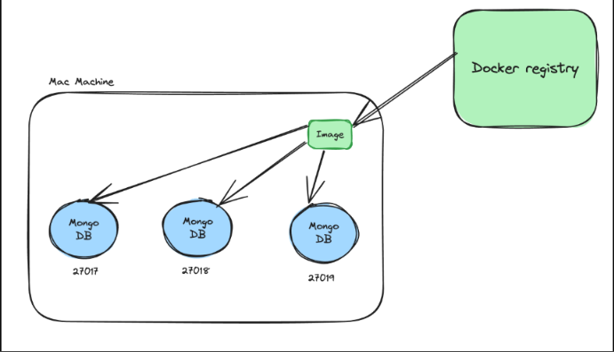
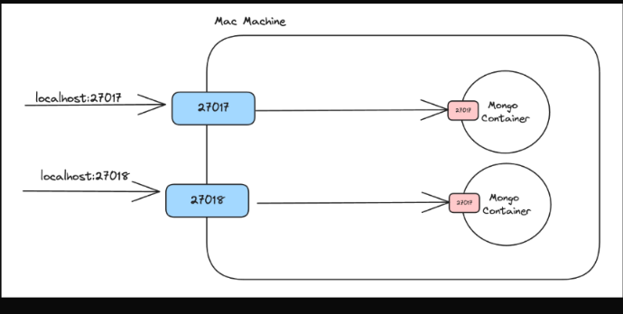
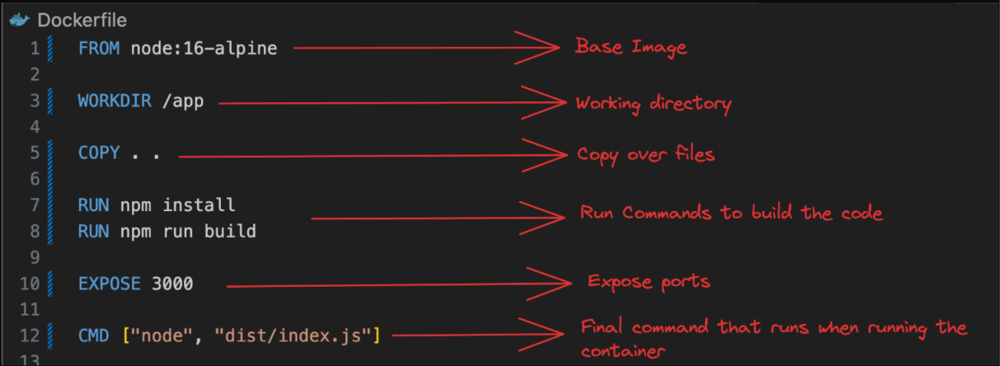
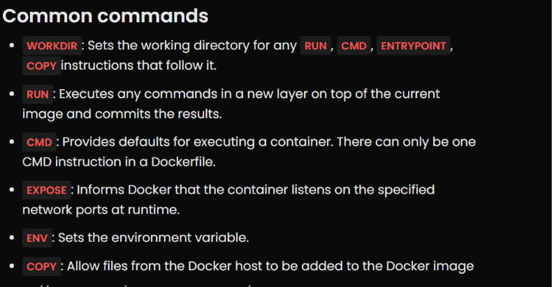
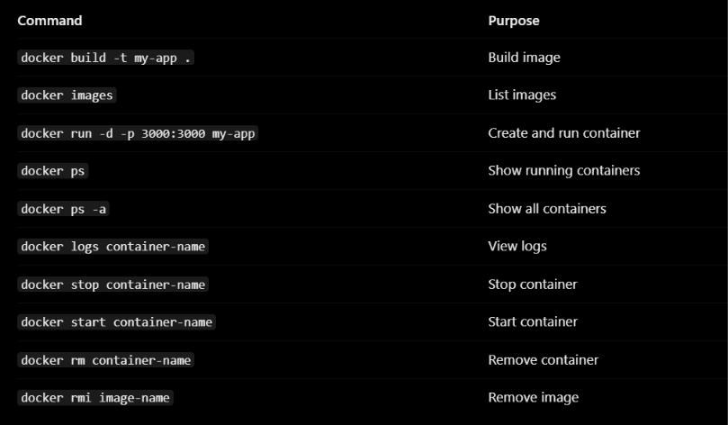

# Docker
 - Docker is a CONTAINER RUNTIME , there are many runtimes.
 - Docker is a tool that allows us to package an application along with everything it needs to run, so it works consistently on different computers and servers.
 - The main idea is that you package the application once and can run it in different environments without manually setting up all its dependencies each time.
    
    - Docker/containers are important for a few reasons - 
       - Kubernetes/Container orchestration
       - Running processes in isolated environments
       - Starting projects/auxilary services locally (very fast)
 

   ## Containers
     Containers are a way to package and distribute software applications in a way that makes them easy to deploy and run consistently across different enviornments. 
     They allow you to package an application, along with all of its dependencies and libraries, into a single unit that can be run on any machine with a container runtime, such as DOCKER.

     - Why containers ??
        - everyone has different operating systems
        - steps to run a project can vary based on OS
        - extremely harder to keep track of dependencies as project grows

    - Benefits of using containers
    
      

      - Let you describe your configuration in a  single file
      - Can run in isolated environments
      - Makes Local setup of OS projects a breeze
      - Makes installing auxiliary services/DBs easy

     ## Inside Docker

    

        u need to be comfortable with the following  terminologies -
            - Docker Engine
            - Docker CLI
            - Docker registry

     ## Docker Engine 
      - Docker Engine is an open-source containerization-technology that allows developers to package applications into container.
      - Docker Engine is the software that actually manages Docker containers.
    
     ## Docker CLI
      - The command line interface lets you talk to the docker engine and lets you start/stop/list containers.
      - Docker cli is not the only way to talk to a docker engine. You can hit the docker REST API to do the same things

     ## Docker registry
      - A Docker Registry is a service that stores and distributes Docker images, allowing developers and servers to upload and download them.
      - registry stores the image, not your running container.   

    ## Images and containers
    ### Docker Image
    - A Docker image is a lightweight, standalone, executable package that includes everything needed to run a piece of software, including the code, a runtime, libraries, environment variables, and config files.

    - A good mental model for an image is Your codebase on github.

    ### Docker Container
    - A container is a "running instance of an image".
    It encapsulates the application or service and its dependencies, running in an isolated environment.

    

    
    ### Important Point
    - Docker containers are isolated from each other and from the host system by default, but the isolation is not absolute.

    - when we create a container it is basically a mini machine running inside our machine but u cant directly access that , for accessing u need port mapping.

    Port mapping establishes a connection between:
    - A port on your host machine.
    - A port inside your Docker container.
     
    - Example :- docker run -d -p 3000:3000 my-node-app
      - Left port = host machine port
      - Right port = container port

    - we can host same container on multiple ports of host machine , each in isloation and individually running.
      - docker run -d -p 27017:27017 mongo
      - docker run -d -p 27018:27017 mongo

      

   ## Common Docker Commands 
     - docker images 
       - Shows you all the images that you have on your machine

     - docker ps
       - Shows you all the containers you are running on your machine

     - docker run 
       - Lets you start a container
       - -p ⇒ let’s you create a port mapping
       - -d. ⇒ Let’s you run it in detatched mode

     - docker build  

     - docker push 
       - Lets you push your image to a registry

     - docker kill
     - docker exec

   ## Creating a Dockerfile  
      - A Dockerfile is a text file containing instructions that Docker uses to build an image, and that image is used to create containers.
      - If you want to create an image from your own code, that you can push to "dockerhub", you need to create a Dockerfile for your application.
      - A dockerfile has 2 parts :-
        1) Base image
        2) Bunch of commands that you run on the base image (to install dependencies like Node.js)

    
        

        
        - FROM specifies the base image on which your Docker image will be built.
            
            Imagine creating a Node.js application. Your machine already has Node.js installed, but Docker containers are isolated environments.
            So we need to provide Node.js inside our image.
            That's what FROM does.

            Imp point: Every Dockerfile generally starts with a FROM instruction, which defines its base image.

        

         
      - some common commands

         

        - -t	Tag (build), TTY (run)
        - -p	Publish ports
        - -d	Detached mode 

      - u can create a ".dockerignore" file inside your project folder.
            Similar to .gitignore.
            Prevents unnecessary files(node modules) from being included in Docker's build context.