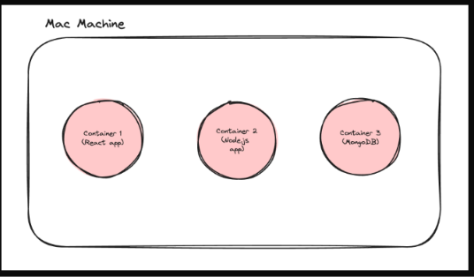
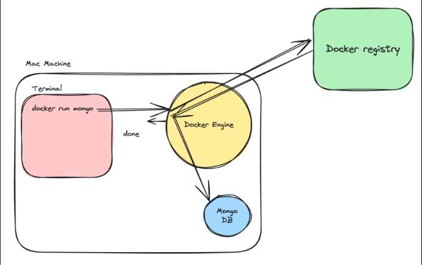

# Docker

 - Docker is a tool that allows us to package an application along with everything it needs to run, so it works consistently on different computers and servers.
 - The main idea is that you package the application once and can run it in different environments without manually setting up all its dependencies each time.
    
    - Docker/containers are important for a few reasons - 
       - Kubernetes/Container orchestration
       - Running processes in isolated environments
       - Starting projects/auxilary services locally (very fast)
 

   ## Containers
     Containers are a way to package and distribute software applications in a way that makes them easy to deploy and run consistently across different enviornments. 
     They allow you to package an application, along with all of its dependencies and libraries, into a single unit that can be run on any machine with a container runtime, such as DOCKER.

     - Why containers ??
        - everyone has different operating systems
        - steps to run a project can vary based on OS
        - extremely harder to keep track of dependencies as project grows

    - Benefits of using containers
    
      

      - Let you describe your configuration in a  single file
      - Can run in isolated environments
      - Makes Local setup of OS projects a breeze
      - Makes installing auxiliary services/DBs easy

     ## Inside Docker

    

        u need to be comfortable with the following  terminologies -
            - Docker Engine
            - Docker CLI
            - Docker registry

     ## Docker Engine 
      - Docker Engine is an open-source containerization-technology that allows developers to package applications into container.
      - Docker Engine is the software that actually manages Docker containers.
    
     ## Docker CLI
      - The command line interface lets you talk to the docker engine and lets you start/stop/list containers.
      - Docker cli is not the only way to talk to a docker engine. You can hit the docker REST API to do the same things

     ## Docker registry
      - A Docker Registry is a service that stores and distributes Docker images, allowing developers and servers to upload and download them.
      - registry stores the image, not your running container.   

         
        

